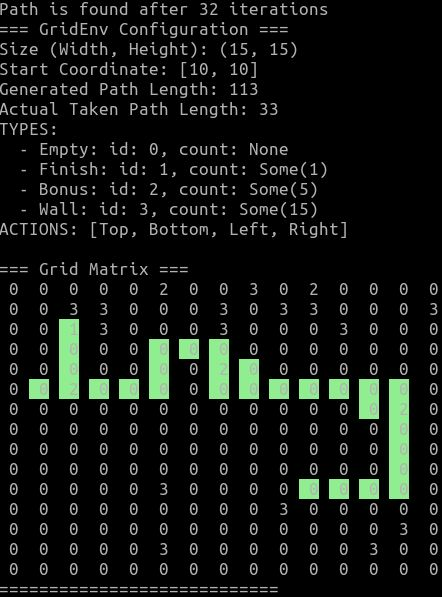

# RL Grid Pathfinder

This repository combines Python-based reinforcement learning, ONNX-backed
inference, and a Rust solver for grid-world pathfinding. The project is
organized around a reusable grid environment, DQN training code, and a fast
compiled solver that can be benchmarked against the Python version.



## Overview
The codebase includes:

- Python packages for generating grid environments and running agents
- DQN model creation, training, and export to ONNX
- A pathfinding wrapper that runs an agent
- A Rust implementation of the solver and a small HTTP service
- Benchmark scripts and notebooks for experimentation and comparison

## Repository layout

- [`jupiter/`](./jupiter/) — notebooks used for experimentation and model analysis. Read for detailed description of project.
- [`python/`](./python/) — packages used for model training
- [`python/pathfinder/`](./python/pathfinder/) — helper that loads a grid and runs an ONNX-backed agent
- [`rust/pathfinder/`](./rust/pathfinder/) — Rust implementation of the grid environment and solver
- [`rust/pathfinder_service/`](./rust/pathfinder_service/) — HTTP API that accepts grid input and returns a path
- [`benchmarks/`](./benchmarks/) — sample data, generated artifacts, and Python/Rust comparison scripts

## Prerequisites

- Python 3.9+
- `pip` for installing packages
- `cargo` if you want to build or run the Rust solver/service

## Quick start

For a complete end-to-end flow, see the package READMEs under [`python/`](./python/)
and the benchmark scripts in [`benchmarks/`](./benchmarks/).

## Python packages

The Python side is split into libraries:

- `grid-env` creates grid maps, renders them, and exports/imports CSV files
- `grid-agent` manages memory maps and DQN model inference
- `pathfinder` loads CSV grids and uses an ONNX model to solve them

## Rust pathfinder and service

The Rust implementation lives in [`rust/pathfinder/`](./rust/pathfinder/) and can be built directly:

```bash
cd rust/pathfinder
cargo build --release
```

The service crate in [`rust/pathfinder_service/`](./rust/pathfinder_service/) exposes a small HTTP API for solving grids from CSV input.

By default the service listens on `0.0.0.0:3005` and loads `model.onnx` from
its local directory. For more details, see [`rust/pathfinder_service/README.md`](./rust/pathfinder_service/README.md).

## Research and notebooks

The [`jupiter/`](./jupiter/) directory contains notebooks used for experimentation, iteration,
and model analysis. These notebooks complement the packaged code and are a
useful place to inspect training logic and result generation.

## Notes

Its just Proof Of Concept!
