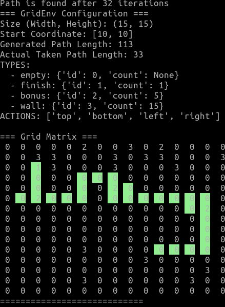

# Benchmarking and model export

This directory contains the scripts used to generate a sample grid, export the
trained DQN model to ONNX, and compare the Python and Rust pathfinding
implementations.

## Generate a 15x15 grid

From this directory, run:

```bash
python generate_grid.py
```

The script prints the grid to the terminal and saves the generated assets in
`runtime/`:

- `grid_output.csv`
- `grid_output.png`

If you want PNG output, install the optional dependency first:

```bash
python -m pip install ".[png]"
```

from `python/grid_env/`.

## Export a DQN model to ONNX

Run:

```bash
python export_model_to_onnx.py
```

This loads `dqn_cnn_model.zip` and writes a matching ONNX file to
`runtime/model.onnx`.

To use a different model or custom output path:

```bash
python export_model_to_onnx.py dqn_cnn_model.zip --output runtime/model.onnx
```

## Run the Python pathfinder


```bash
python run_pathfinder.py
```

The script reads the CSV grid and ONNX model from `benchmarks/runtime/` and
prints the action count and the traversed path.

## Run the Rust pathfinder


```bash
./pathfinder runtime/grid_output.csv runtime/model.onnx
```

This binary is built for the benchmark environment and reads the same runtime
files that the Python pathfinder uses.

## Compare Python and Rust implementations

Benchmarked on Intel(R) Core(TM) i7-7500U CPU @ 2.70GHz.

Both implementations run on the same generated 15x15 grid(Legend: 1 - finish, 2 - bonus, 3 - wall):


The Python and Rust outputs are shown below:

| Python | Rust |
| --- | --- |
|  |  |


Both implementations followed the same path:


To reproduce the timing comparison with `hyperfine`:

```bash
sudo apt install hyperfine
hyperfine --runs 100 \
  "./pathfinder runtime/grid_output.csv runtime/model.onnx" \
  "python run_pathfinder.py"
```

Example result:

```bash
Benchmark 1: ./pathfinder runtime/grid_output.csv runtime/model.onnx
  Time (mean ± σ):      25.3 ms ±   3.4 ms    [User: 24.5 ms, System: 5.6 ms]
  Range (min … max):    23.9 ms …  45.6 ms    100 runs

Benchmark 2: python run_pathfinder.py
  Time (mean ± σ):      1.856 s ±  0.024 s    [User: 1.912 s, System: 0.213 s]
  Range (min … max):    1.838 s …  2.037 s    100 runs

Summary
  './pathfinder runtime/grid_output.csv runtime/model.onnx' ran 73.49 ± 9.98 times faster than 'python run_pathfinder.py'
```
